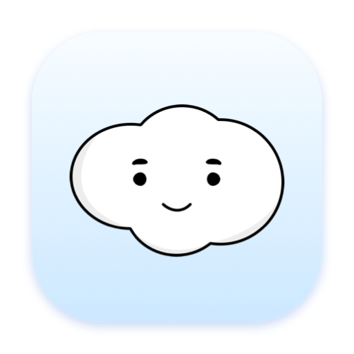
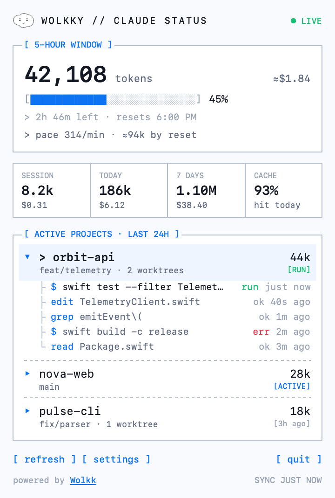
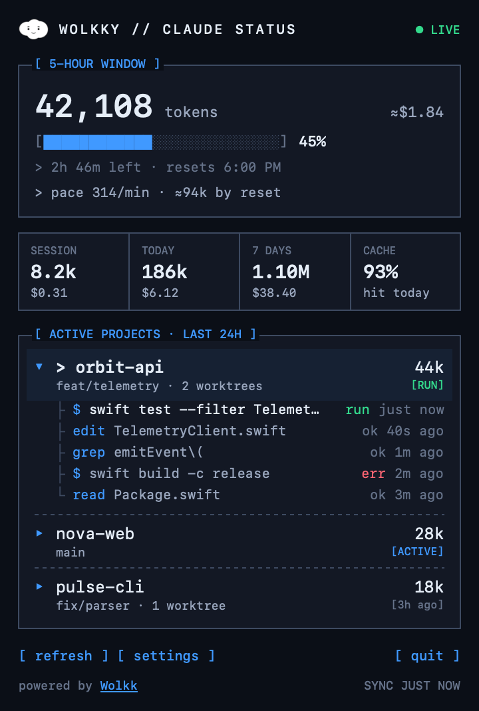

<p align="center">
  
</p>

<h1 align="center">Wolkky Claude Status</h1>

<p align="center">
  A terminal-style macOS menu bar readout for <b>Claude Code</b>, starring Wolkky, Wolkk's mascot:<br>
  token usage, which project folders Claude is working in, and what it's running right now.
</p>

<p align="center">
  Free and open source · Made by <a href="https://wolkk.com/?utm_source=github&utm_medium=readme&utm_campaign=wolkky-claude-status"><b>Wolkk</b></a>
</p>

<p align="center">
  
  &nbsp;
  
</p>

Lives in your menu bar as Wolkky — no text, no wasted space. Hover for a quick summary, click for the panel.

> **Need more hands on your product?**
> [Wolkk](https://wolkk.com/?utm_source=github&utm_medium=readme&utm_campaign=wolkky-claude-status) gives your team senior developers from Indonesia, as a dedicated team or alongside your in-house developers. [See how Wolkk works →](#about-wolkk)

## Features

- **5-hour window** — tokens used in the current usage window, a text progress bar `[█████░░░░░]` for time elapsed (or % of your own budget), time left, reset time and an estimated cost.
- **Notifications** — Wolkky taps you when Claude finishes a task (1+ minute of work), when Claude asks you a question, and at 80 / 90 / 100% of your 5-hour budget. Only while you're in another app, if you like. Click a notification to open the panel.
- **Limit forecast** — your pace in tokens per minute and where the window lands by reset. With a budget set: "at this pace: limit ≈ 16:40". Settings suggests a budget from your busiest 5-hour window this week.
- **Context meter** — expand a project to see how full its latest session's context window is (`context [██████░░░░] 45% · 448k/1M`), red when it's time to `/compact`.
- **Session, today, 7 days** — token totals and estimated cost, plus today's cache hit rate.
- **Active projects** — every folder Claude worked in during the last 24 hours, newest first, with a live / active / idle dot, branch, worktree count and tokens. Claude Code worktrees and subfolders fold into their repo, so `AVIREO/.claude/worktrees/…` shows as **AVIREO**.
- **What's running** — click a project to expand it and see Claude's latest commands there (`$ swift build`, `edit PanelView.swift`, `grep …`) with `run` / `ok` / `err` status.
- **ASCII theme** — monospace text, boxed sections, tree lines and `[ button ]` controls.
- **Setup wizard** — a terminal installer and a first-run window that checks everything for you.
- **English, Deutsch, 日本語** — pick a language in Settings, or let it follow your Mac. Switches live.
- **Light or dark** — light by default, with a Dark mode switch in Settings. Your choice, not tied to the system setting.
- **Tiny** — native SwiftUI, about 1 MB, no Electron, no background services. Reads only new log lines after the first scan.
- **Private** — no network, no API keys, no telemetry. Runs in the App Sandbox.

## Requirements

- macOS 14 Sonoma or newer (Apple silicon or Intel)
- Xcode Command Line Tools (the installer offers to install them)
- [Claude Code](https://docs.claude.com/en/docs/claude-code) — the app reads its local logs

## Install

```bash
git clone https://github.com/antoniowolkk/claudestatus.git
cd claudestatus
./install.sh
```

The wizard walks through 7 steps:

| Step | What happens |
| --- | --- |
| 1. Check your Mac | macOS version and architecture |
| 2. Toolchain | Finds Swift; offers Apple's installer if it's missing |
| 3. Claude Code | Looks for `~/.claude/projects` and counts this week's sessions |
| 4. Location | `~/Applications` (no password) or `/Applications` |
| 5. Build | Compiles from source, signs with App Sandbox + hardened runtime |
| 6. Install | Replaces any running copy |
| 7. Launch | Opens the app; a setup window checks data access, dark mode and open at login |

Non-interactive: `./install.sh --yes` (installs to `~/Applications` and opens the app).

Update later with `git pull && ./install.sh`.

### Build by hand

```bash
scripts/build-app.sh               # → build/Wolkky Claude Status.app
scripts/build-app.sh --universal   # Apple silicon + Intel (needs full Xcode)
```

## Use

Click **Wolkky** in the menu bar to open the panel; hover for a one-line summary (tokens, model, project). Press Esc or click anywhere else to close it.

- `[ refresh ]` scans the logs now (it also refreshes on its own every 20 seconds)
- `[ settings ]` opens Settings
- `[ quit ]` quits
- **powered by Wolkk** opens wolkk.com

### Settings

| Tab | Options |
| --- | --- |
| General | Dark mode, language, notifications, counting cache reads, a 5-hour token budget, refresh rate, open at login, rerun setup |
| Privacy | What the app reads and never does, and a shortcut to the logs folder |
| About | Version, Wolkky, Wolkk website and source code |
| Wolkk | What Wolkk is and what it can do for you: dedicated and hybrid teams, agile development, with links to contact Wolkk |

### Active projects

Each row is one project with Claude activity in the last 24 hours. Hover the menu bar icon for the model you're on.

| Tag | Meaning |
| --- | --- |
| `[RUN]` | A command is running right now |
| `[LIVE]` | Message in the last 2 minutes |
| `[ACTIVE]` | Message in the last 30 minutes |
| `[3h ago]` | Idle; shows how long ago |

Click a row to expand it. Each line is one tool call: `$` shell command, `edit` / `read` / `write` file, `grep` / `glob` search, `agent`, `mcp`, and so on. Status is `run` (still running), `ok`, `err` (failed) or `stop` (no result after 15 minutes, likely interrupted). Up to 8 recent calls per project.

The highlighted row, marked `>`, is the project you're in now. Hover a row to see its full path. Up to 6 projects are listed.

## How usage is counted

Claude Code writes one JSON line per message to `~/.claude/projects/<project>/<session>.jsonl`. Wolkky Claude Status reads the assistant messages from the last 8 days and removes duplicates.

- **Tokens** = input + output + cache writes. Cache reads are left out by default because they're cheap and can be huge; turn them on in Settings.
- **5-hour window** starts at the hour of your first message and lasts 5 hours, the same way Claude plans count usage limits. A new window starts with the first message after it ends.
- **Cost** is an estimate from public Anthropic API list prices per model, including cache write and read rates. On a Pro or Max plan you aren't billed per token; treat it as a "what this would cost on the API" number.

## Security and privacy

| | |
| --- | --- |
| Network | None. The App Sandbox blocks all network access; the app has no network entitlement. |
| Files | Read-only access to `~/.claude/projects/`. Nothing else, enforced by the sandbox. |
| What's kept | Token counts, model, folder path, branch, and a one-line summary of recent commands (first line of a shell command, a file name or a search term), in memory only. Message text and command output are discarded while parsing. |
| Writes | Only its own settings, inside its sandbox container. Never writes to `~/.claude`. |
| Secrets | No API keys, tokens or accounts. |
| Telemetry | None. |
| Links | The Wolkk links open wolkk.com in your browser with campaign tags that name only the app and the button (`utm_source=wolkky-claude-status&utm_medium=app&utm_content=panel-footer`). Nothing about you or your usage is added. |
| Install | Built from source on your Mac. No `curl \| bash`, no downloads, no `sudo` unless you choose `/Applications`. |
| Signing | Ad-hoc signed with hardened runtime. Set `SIGN_IDENTITY` to sign with your own Developer ID. |

Symlinks inside the logs folder are skipped and oversized log lines are dropped.

Found a security issue? See [SECURITY.md](SECURITY.md).

## Uninstall

```bash
./uninstall.sh
```

Asks before removing the app and its settings. Your Claude Code logs are never touched.

## Troubleshooting

**Nothing in the menu bar.** If you have many menu bar items, macOS hides the ones that don't fit. Quit a few, or hold ⌘ and drag icons to make room.

**"Logs not found".** Run a Claude Code session first. The app looks in `~/.claude/projects`.

**"Open at login" shows an error.** Move the app to `~/Applications` or `/Applications` first (the installer does this), then toggle it again.

**Branch shows "no branch".** The folder isn't a git repository, or Claude Code was on a detached HEAD.

## Project layout

```
Sources/ClaudeStatus/
  ClaudeStatusApp.swift   app entry, windows, login item
  StatusController.swift  menu bar item + instant, animation-free panel
  LogScanner.swift        incremental, read-only log parser + 5-hour windows
  UsageStore.swift        refresh loop and menu bar tooltip
  Pricing.swift           per-model price table for cost estimates
  PanelView.swift         menu bar panel
  SettingsView.swift      settings window
  OnboardingView.swift    first-run setup
  Theme.swift             colors, ASCII boxes and progress bar
  WolkkyImage.swift       embedded Wolkky mascot (generated)
  Strings.swift           English, German and Japanese text
  Appearance.swift        dark mode and live language switching
Resources/                Info.plist, entitlements, icon
scripts/                  build-app.sh, make-icon.swift, prepare-mascot.swift
install.sh / uninstall.sh
```

Developer helpers: `--dump` prints what the scanner found (finished turns, open questions, context per project). Render the panel to a PNG without opening the menu bar (handy for docs):

```bash
.build/release/ClaudeStatus --snapshot panel.png --demo
```

## About Wolkk


**[Wolkk](https://wolkk.com/?utm_source=github&utm_medium=readme&utm_campaign=wolkky-claude-status)** is your gateway to senior software developers from Indonesia. Wolkky, the cloud in your menu bar, is Wolkk's mascot. We built this app because we use Claude Code every day, and we wanted to see what it's doing without switching windows.

If you build with Claude Code, here's where Wolkk can help:

| | |
| --- | --- |
| **Dedicated teams** | Full-time senior developers who work only on your product, with your tools and your processes. |
| **Hybrid teams** | Wolkk developers alongside your in-house team, scaling up or down as you need, with knowledge transfer built in. |
| **Agile delivery** | Sprint-based development with continuous iteration. |
| **Everything around the code** | Project management, systems architecture and analysis, UI/UX design, DevOps, maintenance, IT support and service desk. |

Wolkk works with small and medium-sized companies, CTOs and founders in Europe and the US. Senior developers can start in about **4 weeks**, at up to **60% lower cost** than hiring locally (Wolkk's own figures).

**[Talk to Wolkk →](https://wolkk.com/contact?utm_source=github&utm_medium=readme&utm_campaign=wolkky-claude-status)** &nbsp;·&nbsp; [Services](https://wolkk.com/services?utm_source=github&utm_medium=readme&utm_campaign=wolkky-claude-status) &nbsp;·&nbsp; [About](https://wolkk.com/about?utm_source=github&utm_medium=readme&utm_campaign=wolkky-claude-status) &nbsp;·&nbsp; [Blog](https://wolkk.com/blog?utm_source=github&utm_medium=readme&utm_campaign=wolkky-claude-status) &nbsp;·&nbsp; [Careers](https://wolkk.com/career?utm_source=github&utm_medium=readme&utm_campaign=wolkky-claude-status) &nbsp;·&nbsp; [Deutsch](https://wolkk.com/de?utm_source=github&utm_medium=readme&utm_campaign=wolkky-claude-status)

---

<p align="center">
  Made with ☁ by <a href="https://wolkk.com/?utm_source=github&utm_medium=readme&utm_campaign=wolkky-claude-status">Wolkk</a> · Wolkky is Wolkk's mascot<br>
  <sub>Not made by or affiliated with Anthropic. Claude Code is a product of Anthropic.</sub>
</p>
